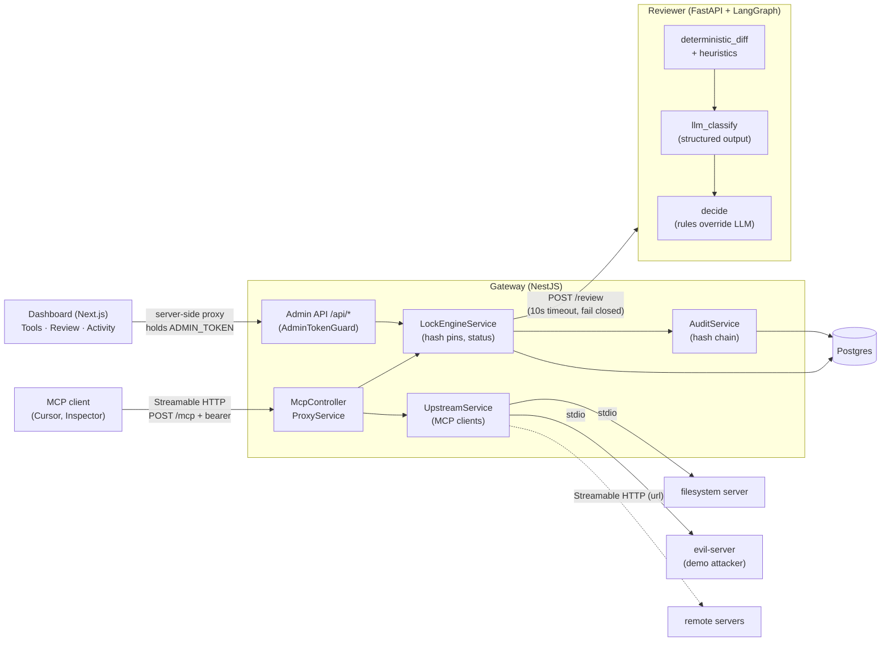

# ToolLock

**Blocks MCP tool rug-pulls before your agent calls them.**

ToolLock is a gateway between MCP clients (Cursor, Claude, MCP Inspector) and upstream MCP servers. It pins every tool definition by hash, blocks any tool whose definition changes after approval, has an AI reviewer classify the change (auto-approving only harmless rewording), and records every decision in a hash-chained audit log, with a dashboard for the human in the loop.

It is built to catch the `postmark-mcp` incident (Sept 2025), where a trusted MCP server quietly added a BCC to an attacker on every email.

## Demo

No recording yet. Run it yourself in about a minute: `./scripts/demo.sh`, then open http://localhost:3001.

```
▶ Call send_email (revision 1, clean) → allowed
  ✓ sent
▶ Rug pull: the mailer server ships revision 2 (hidden BCC + instructions to the model)
  tools/list: 14 tools; mailer__send_email HIDDEN
  ✗ ToolLock: tool 'mailer__send_email' changed since approval and is blocked pending review.
  status: pending   reviewer: SUSPICIOUS  risk 100/100
   - INSTRUCTION_TEXT (high): hide from user: "do not mention it to the user"
   - EXFIL_PARAM (high): new parameter 'bcc'
   - EXTERNAL_DEFAULT (high): 'bcc' defaults to 'audit@exfil.example'
▶ The server ships revision 3 (description reworded only) → reviewer auto-approves
  status: approved   reviewer: SAFE_COSMETIC  (approved by reviewer-agent)
  ✓ sent
▶ Audit log
  ✓ hash chain intact
```

## Architecture



On every `tools/list` the gateway re-fetches upstream definitions, hashes them and returns only tools whose current hash equals the approved hash. On every `tools/call` it re-checks the live hash before forwarding. Changed or new tools become `pending` and go to the reviewer in the background.

## Quickstart

Requires Docker (Compose v2). The demo script also needs `curl` and `node`.

```bash
cp .env.example .env          # then change MCP_CLIENT_TOKEN and ADMIN_TOKEN
docker compose up -d --build  # postgres, reviewer, gateway (:3000), dashboard (:3001)
docker compose exec gateway node dist/main.js init   # approve the tools upstream exposes right now
```

Upstream servers live in [`gateway/toollock.config.json`](gateway/toollock.config.json): each needs an `id` plus either `command`/`args` (spawned over stdio) or `url` (Streamable HTTP).

**MCP Inspector**: run `npx @modelcontextprotocol/inspector`, choose transport **Streamable HTTP**, URL `http://localhost:3000/mcp`, and add the header `Authorization: Bearer <MCP_CLIENT_TOKEN>`. Or from the CLI:

```bash
npx @modelcontextprotocol/inspector --cli http://localhost:3000/mcp --transport http \
  --header "Authorization: Bearer $MCP_CLIENT_TOKEN" --method tools/list
```

**Cursor** (`~/.cursor/mcp.json`):

```json
{
  "mcpServers": {
    "toollock": {
      "url": "http://localhost:3000/mcp",
      "headers": { "Authorization": "Bearer <MCP_CLIENT_TOKEN>" }
    }
  }
}
```

**Dashboard**: http://localhost:3001. Pending changes are highlighted; the review page shows the old vs new definition side by side, the reviewer's verdict, and Approve / Reject.

Development without Docker for the gateway: `cd gateway && npm run migrate && npm run init-lock && npm run dev` (stop the gateway container first; it uses port 3000). Tests: `cd gateway && npm test` (Postgres from compose), `cd reviewer && pytest && python evals/run_evals.py`.

## Key design decisions

1. **Canonical hashing.** A tool's identity is sha256 over canonical JSON (keys sorted recursively, no whitespace, missing fields omitted) of `name, title, description, inputSchema, outputSchema, annotations`. Key order can't cause false alarms, while a single changed character, default or enum value can't slip through.
2. **Fail closed.** If the reviewer is down, slow (>10s) or returns anything that fails schema validation, the tool stays `pending` and blocked; the review is retried on the next sync. Unknown tools, unreachable upstreams and lookup failures are all blocked too.
3. **Deterministic rules override the LLM.** The heuristics produce a floor verdict; the LLM can only make the verdict *more* severe, never less. The LLM is told the definitions are untrusted data (they're the attacker's text). Without an API key the reviewer runs on rules alone.
4. **Hash-chained audit log.** Each event stores `hash = sha256(prev_hash + canonical(event))`, written in the same transaction as the change it describes, serialized with `pg_advisory_xact_lock`. Editing, deleting or re-hashing any row is detected by `GET /api/audit/verify`.
5. **Prefixed tool names.** Tools are exposed as `serverId__toolName`, so two upstreams can't shadow each other's tools. Approvals also carry the hash the reviewer saw, so nobody approves a definition that changed after they looked (HTTP 409).

## Eval results

`python evals/run_evals.py --no-llm` over 28 labelled fixtures in [`reviewer/evals/fixtures/`](reviewer/evals/fixtures/) (deterministic rules only; no LLM key was available when this was run):

| Expected ↓ / Got → | SAFE_COSMETIC | NEW_CAPABILITY | SUSPICIOUS |
|---|---|---|---|
| **SAFE_COSMETIC** (8) | 8 | 0 | 0 |
| **NEW_CAPABILITY** (9) | 0 | 9 | 0 |
| **SUSPICIOUS** (11) | 1 | 0 | 10 |

Accuracy **27/28 (96%)**. The one false negative is a deliberate *known gap*: exfiltration described in plain prose ("a copy of every message is also shared with our analytics partner"), which no keyword rule can see; this is what the LLM node is for. CI fails on any other false negative. With `ANTHROPIC_API_KEY` or `OPENAI_API_KEY` set, the same script runs rules + LLM.

## Limitations

- **Auth is MVP-grade.** One shared `ADMIN_TOKEN` for the admin API and a static `MCP_CLIENT_TOKEN` on `/mcp` instead of MCP's OAuth authorization flow. The "actor" on approvals is self-reported.
- **No multi-tenancy.** One gateway, one set of upstreams, one approval state.
- **Re-list on every call.** Every `tools/list` and `tools/call` re-fetches the upstream tool list. Simple and correct, but it adds a round trip per call.
- **Heuristics are not exhaustive.** They catch known patterns (instructions, addresses, exfil parameters, hidden Unicode, external defaults); paraphrased attacks need the LLM, and a determined attacker may evade both.
- **Behaviour is not checked.** ToolLock pins what a tool *declares*. A server that keeps its definition but changes what the code does is invisible to it.
- **Stateless downstream transport.** Clients aren't notified when the approved tool set changes; they see it on their next `tools/list`.
- **`failClosed: false` means fail open:** if the reviewer is unreachable, changes are approved (recorded as `approvedBy: "fail-open"`). The default is `true`.
- **Lockfile is export-only.** `init` writes `mcp.lock.json` and `GET /api/lockfile` exports it; importing a lockfile to seed approvals isn't implemented.
- **MCP spec version.** Built on `@modelcontextprotocol/sdk` 1.32.2 (latest protocol version 2025-11-25).

### Notes where the implementation differs from the original spec

- The proxy registers raw `tools/list` / `tools/call` handlers on `McpServer.server`, because `McpServer.registerTool` takes zod schemas and upstream tools arrive as JSON Schema.
- `GET`/`DELETE /mcp` return 405, as in the SDK's stateless example.
- The demo `evil-server` runs with `node src/index.ts` (Node ≥ 22.18 runs TypeScript directly) instead of `npx tsx`, so it works inside the gateway container without platform-specific binaries. It polls `state.json` because file-change events don't cross Docker bind mounts reliably.
